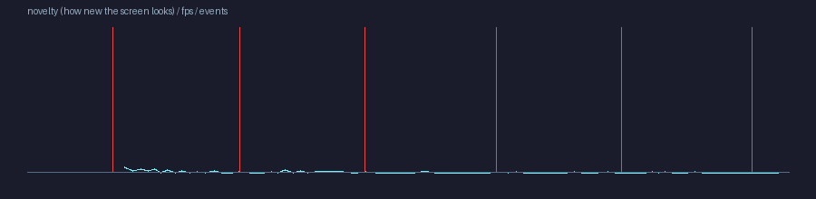
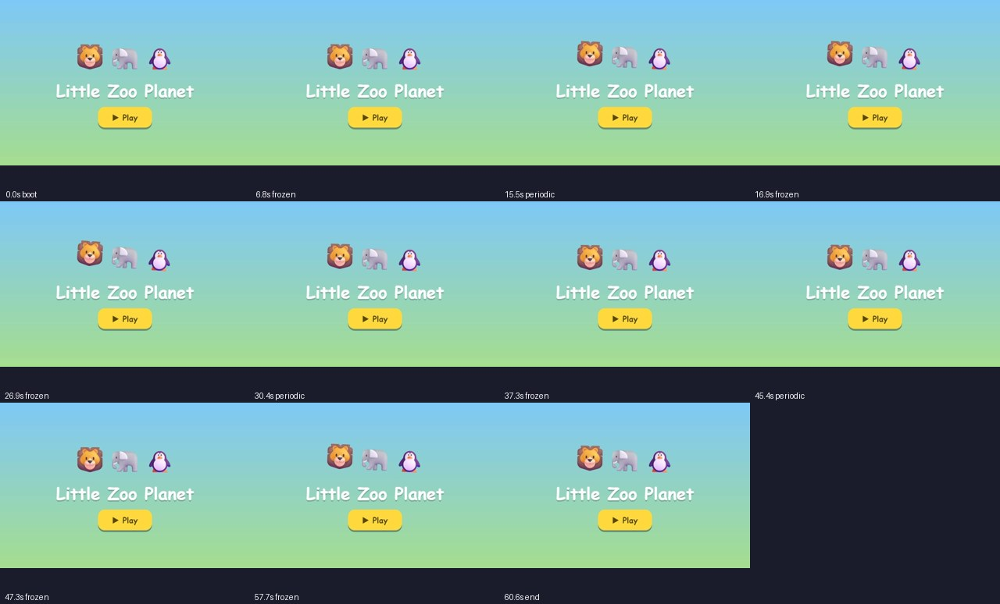

# Playtest report — ROUGH

- policy **explorer**, 60.6s, telemetry: False
- FPS avg None / p5 None / min None
- events: {} · deaths 0 · wins 0 · first event at Nones
- explored 0 map cells · mean novelty 0.0001

## Issues

- **[major]** Input had no visible effect — screen unchanged for 6s while input was held (t=6.8s) 
- **[major]** Input had no visible effect — screen unchanged for 6s while input was held (t=16.9s) 
- **[major]** Input had no visible effect — screen unchanged for 6s while input was held (t=26.9s) 
- **[major]** Input had no visible effect — screen unchanged for 6s while input was held (t=37.3s) 
- **[major]** Input had no visible effect — screen unchanged for 6s while input was held (t=47.3s) 
- **[major]** Input had no visible effect — screen unchanged for 6s while input was held (t=57.7s) 
- **[design]** Low-novelty stretch (likely boring) — 8s–60s: the screen barely changed and nothing happened (t=7.75s)

